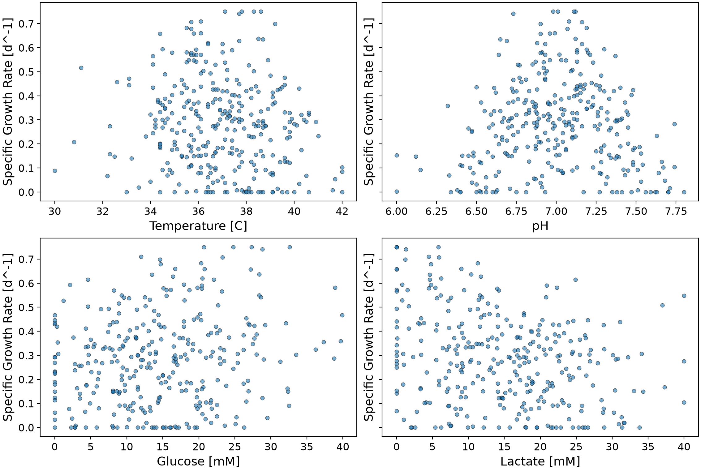
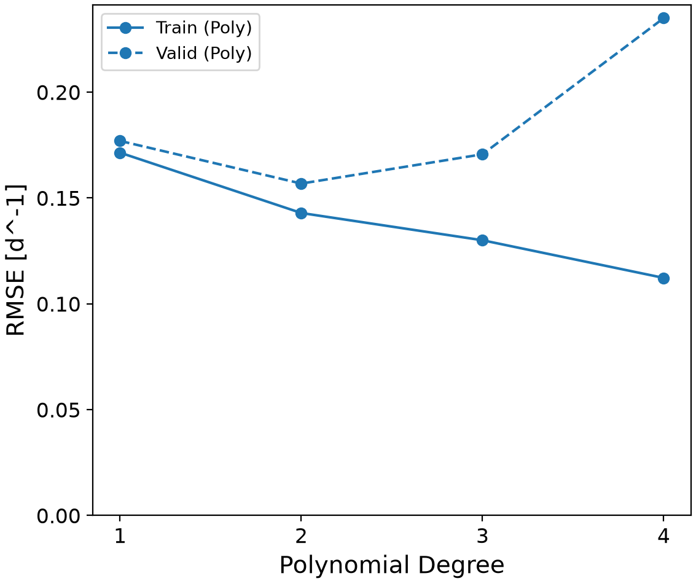
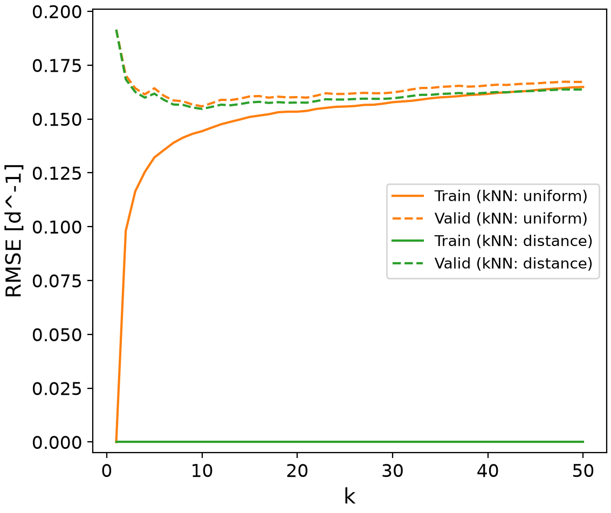
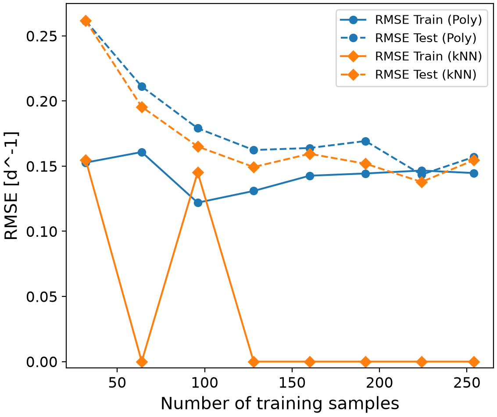
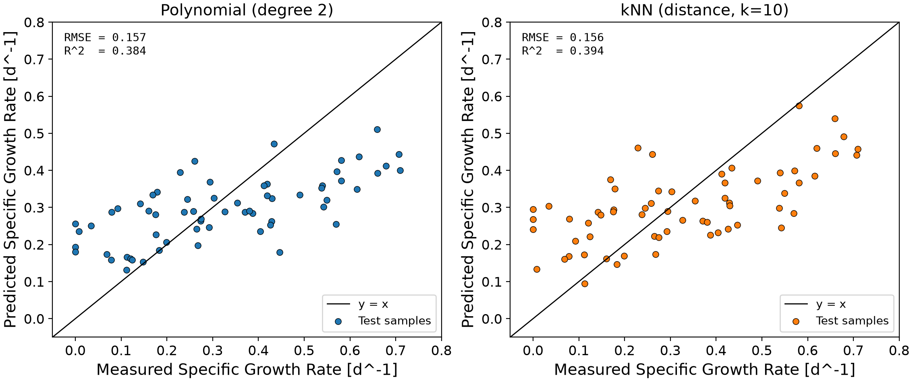
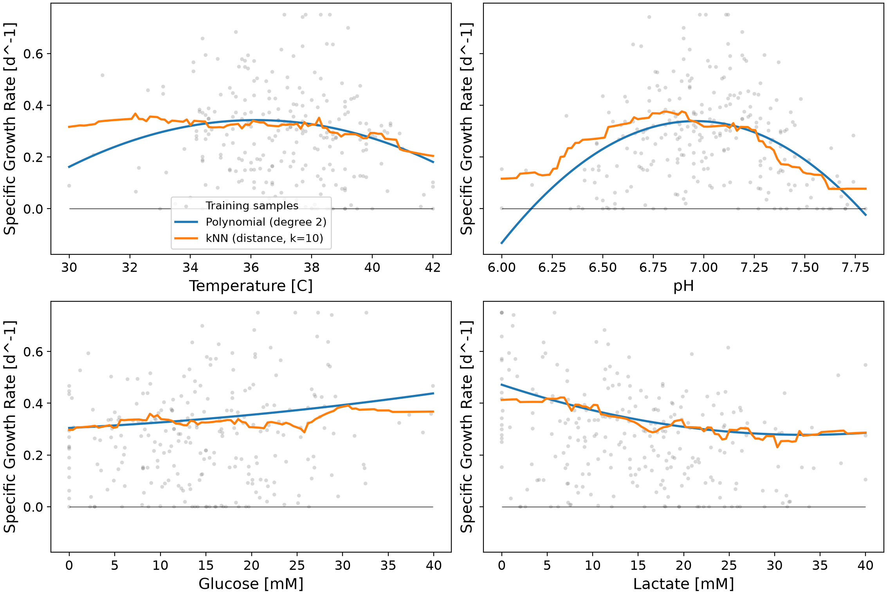
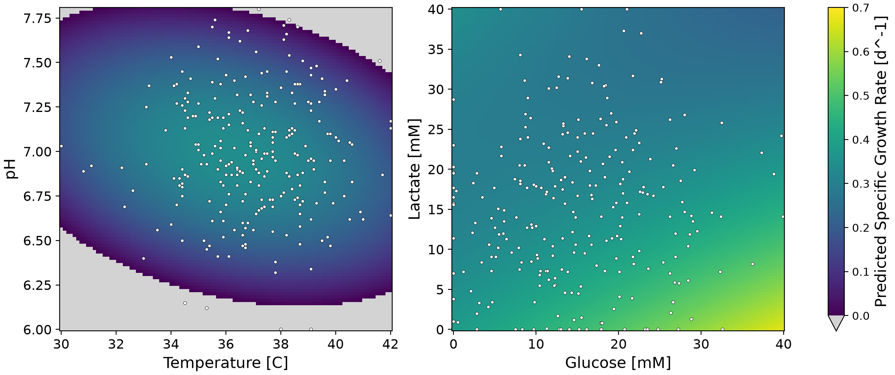

# Cell Growth Rate Regression

This project predicts the specific growth rate of cells from four culture conditions: temperature, pH, glucose
concentration, and lactate concentration. The growth rate cannot be set directly in a bioreactor, so a model that links
it to conditions we can control is useful. Polynomial and k-nearest neighbors (kNN) regression models are tuned,
compared, and interpreted to find which conditions give fast growth and where the predictions should not be trusted.

## Highlights

- Built a regression workflow using scikit-learn pipelines
- Tuned polynomial and kNN models with GridSearchCV
- Compared five candidate models using cross-validation and test data
- Analyzed how training set size affects model selection
- Visualized feature effects with response curves and maps

## Environment

- Python 3.14.7
- matplotlib 3.11.0
- numpy 2.5.2
- pandas 3.0.5
- scikit-learn 1.9.0

## Code Design

`main.py` creates one `GrowthRateStudy` object and calls its methods in order. The class is defined in
`src/classes.py`, helper functions such as the model pipelines are in `src/functions.py`, and settings such as the
hyperparameter grids and plot sizes are in `src/constants.py`. Every step saves its results to `tables/` (CSV) or
`figures/` (PNG), so the analysis can be checked without running the code again.

### Data Loading and Splitting

When the object is created, the dataset is loaded with pandas. The first column (specific growth rate) is used as the
target and the other four columns are used as features. The data is then split into a training set (254 samples) and a
test set (64 samples) with a fixed random state. The test set is not used for any decision about the model. It is kept
aside so that the final models can be checked on data they have never seen. A scatter plot of the growth rate against
each feature is also saved. This step shows the shape of each relationship before any model is chosen, for example
that pH has a clear optimum, which a straight line cannot describe.

### Hyperparameter Tuning

Both models are built as pipelines. The polynomial pipeline is `StandardScaler`, `PolynomialFeatures`, and
`LinearRegression`. The kNN pipeline is `StandardScaler` and `KNeighborsRegressor`. Standardizing is needed for kNN
because it uses distances, and without scaling, a change of 1 mM glucose would count the same as a change of 1 pH unit.
For the polynomial model it keeps the squared and cross terms at a similar scale so the coefficients can be compared.
Putting the scaler inside the pipeline means it is fitted again on the training part of each fold, so no information
from the validation part leaks into training.

`GridSearchCV` with 5-fold cross-validation then tries polynomial degrees 1 to 6, and k from 1 to 50 with uniform and
distance weighting. This step exists because the hyperparameters control the balance between underfitting and
overfitting and have to be chosen from validation data. The full grid search results are saved as tables, and the
validation curves are saved as figures.

### Model Comparison

The best models are compared with reasonable alternatives: polynomial models one degree lower and one degree higher
than the best degree, and the best k for each kNN weighting. Each candidate is evaluated with 5-fold cross-validation on
the training set and then on the test set, and the RMSE and R² are saved in one table. Looking at the cross-validation
mean together with its standard deviation shows whether a difference between two models is larger than the normal
variation between folds. This table is the main evidence for the model choice in the Analysis section.

### Learning Curve

The grid searches are repeated on random subsets of the data with 40 to 318 samples. For each subset, the best
hyperparameters and the train and test RMSE are recorded. This shows how each model behaves when less data is
available and whether more data would still reduce the error. It also shows how the best polynomial degree changes
with the amount of data.

### Test Set Evaluation

The best polynomial and kNN models are used to predict the test set, and the predictions are plotted against the
measured values. A perfect model would put every point on the line y = x. This plot shows where the errors happen, for
example whether slow or fast cultures are predicted badly, which a single RMSE value cannot show.

### Model Interpretation

Three outputs explain what the models learned. First, the coefficients of the polynomial model are saved. Because the
features are standardized, each coefficient is the change in growth rate for a one standard deviation change in that
term, so the coefficients can be compared directly. Second, response curves show the predicted growth rate when one
feature is changed and the other three are held at their median values, for both models. Third, response maps show
the polynomial prediction over temperature and pH, and over glucose and lactate. The maps also report where the
prediction is highest and how much of the map is predicted below zero, which is physically impossible.

### Scenario Predictions

Finally, both models predict the growth rate for example operating conditions, such as fresh medium, a culture with
acidic pH and high lactate, and two conditions outside the range of the training data. Each condition is checked
against the minimum and maximum of the training data. This connects the models to practical decisions and shows how
each model behaves when it is used outside the data it was trained on.

## Analysis

### Data Overview

The dataset has 318 simulated cultures. The growth rate ranges from 0 to 0.75 d⁻¹ with a mean of 0.283 d⁻¹, and 24
cultures have a growth rate of exactly zero, which suggests that negative values were clipped to zero. The scatter
plots show a clear optimum for pH, a weaker optimum for temperature, an increase with glucose, and a decrease with
lactate. The correlation between pH and growth rate is only 0.013 even though pH has a strong effect. This is because
the correlation coefficient only measures straight-line relationships, and the increase below the optimum cancels the
decrease above it. This already shows that a linear model will not be enough. The data is also very noisy: cultures
with almost the same conditions can have very different growth rates, so no model is expected to reach a high R².

### Choice of Model and Hyperparameters

| Degree | Train RMSE [d⁻¹] | Validation RMSE [d⁻¹] | Validation SD [d⁻¹] |
|-------:|-----------------:|----------------------:|--------------------:|
|      1 |           0.1714 |                0.1770 |              0.0130 |
|      2 |           0.1429 |                0.1568 |              0.0156 |
|      3 |           0.1300 |                0.1706 |              0.0152 |
|      4 |           0.1122 |                0.2350 |              0.0584 |
|      5 |           0.0858 |                0.6180 |              0.2048 |
|      6 |           0.0000 |               20.5304 |              6.6344 |

I chose a second-order polynomial regression model. The validation curve shows the bias-variance trade-off. Degree 1
underfits because a straight line cannot describe the optimum in pH or temperature. Degree 2 has the lowest validation
RMSE. From degree 3, the training RMSE keeps going down while the validation RMSE goes up, which means the model starts
to fit noise. With four features, the number of polynomial terms grows quickly (14 terms for degree 2, 34 for degree 3,
and 209 for degree 6). At degree 6 there are more terms than the roughly 203 samples in each training fold, so the
model passes through every training point (training RMSE of zero) and fails on new data.

A quadratic is also a reasonable shape for this problem. It is the simplest model that can have a maximum inside the
data range, which is how pH and temperature affect cells. Its cross terms also allow the effect of one feature to
depend on another, for example glucose being less useful when lactate is high. The features are standardized before
the polynomial terms are created, and ordinary least squares is used without regularization, since 15 coefficients are
fitted with 254 training samples and the gap between training and validation RMSE is small (0.143 vs 0.157 d⁻¹).

### Comparison with Alternative Models

| Model                 | Train RMSE [d⁻¹] | Validation RMSE [d⁻¹] | Validation R² | Test RMSE [d⁻¹] | Test R² |
|-----------------------|-----------------:|----------------------:|--------------:|----------------:|--------:|
| Polynomial (degree 1) |           0.1714 |       0.1770 ± 0.0130 |         0.007 |          0.1907 |   0.092 |
| Polynomial (degree 2) |           0.1429 |       0.1568 ± 0.0156 |         0.185 |          0.1570 |   0.384 |
| Polynomial (degree 3) |           0.1300 |       0.1706 ± 0.0152 |         0.042 |          0.1531 |   0.414 |
| kNN (uniform, k=10)   |           0.1443 |       0.1559 ± 0.0111 |         0.228 |          0.1584 |   0.374 |
| kNN (distance, k=10)  |           0.0000 |       0.1547 ± 0.0107 |         0.237 |          0.1557 |   0.394 |

The best kNN model uses k = 10 with distance weighting. Its validation RMSE (0.1547 d⁻¹) is slightly lower than the
degree-2 polynomial (0.1568 d⁻¹), and it is also slightly better on the test set (0.156 vs 0.157 d⁻¹). However, the
difference of 0.002 d⁻¹ is much smaller than the standard deviation between folds (0.011 to 0.016 d⁻¹), so the two
models perform the same within the noise of the data. The degree-3 polynomial has the lowest test RMSE, but it has a
much higher validation RMSE than degree 2. A single test set of 64 samples is not enough to prefer it, and choosing a
model because of its test score would turn the test set into another validation set.

Since the accuracy is almost the same, I chose the polynomial model for other reasons. It is interpretable: its 15
coefficients show how each feature and each interaction affects growth, while kNN has to store all 254 training samples
and cannot be written as an equation. It is smooth: with distance weighting, each training sample is its own nearest
neighbour at a distance of zero, so kNN reproduces every training value exactly (training RMSE of zero) and its
response curves are jagged. It is also easy to use in practice, since an equation can be put into a spreadsheet or a
control system. kNN does have advantages. It never predicts a negative growth rate because it only averages measured
values, and it does not assume any shape.

| Training samples | Best degree | Poly test RMSE [d⁻¹] | Best kNN       | kNN test RMSE [d⁻¹] |
|-----------------:|------------:|---------------------:|----------------|--------------------:|
|               32 |           1 |               0.2615 | uniform, k=16  |              0.2616 |
|               64 |           1 |               0.2111 | distance, k=6  |              0.1955 |
|               96 |           2 |               0.1791 | uniform, k=11  |              0.1651 |
|              160 |           2 |               0.1639 | distance, k=9  |              0.1595 |
|              254 |           2 |               0.1571 | distance, k=11 |              0.1546 |

The learning curve shows that both models improve with more data and reach a similar error. With 64 or fewer training
samples, the grid search chooses degree 1, because there is not enough data to estimate the 15 coefficients of a
quadratic reliably. From 96 samples, degree 2 is chosen every time, which supports degree 2 as the right complexity for
this dataset. The test RMSE values at each point are noisy because the test sets are small.

### Advantages and Limitations

The main advantages of the model are that it is simple, interpretable, smooth, and fast. The main limitation is its
accuracy for a single culture. The test R² is 0.384, so most of the variation in growth rate is not explained by these
four features, and a typical error of 0.157 d⁻¹ is more than half of the mean growth rate. The parity plot shows that
the predictions are pulled toward the middle: slow cultures are overpredicted and fast cultures are underpredicted.
Both models show the same pattern, which suggests it comes from the noise in the data and not from the model choice.

The quadratic shape also has limits. It forces the optimum to be symmetric and it cannot flatten out at zero, so the
predicted growth rate becomes negative at extreme pH values. Least squares also treats the 24 clipped zero values as
exact measurements. Finally, the glucose effect is almost linear, so the model does not show the saturation that would
be expected at high glucose.

### Effect of Each Feature

| Term                  | Coefficient [d⁻¹] |
|-----------------------|------------------:|
| Intercept             |            0.3383 |
| [pH]^2                |           -0.0610 |
| [Lactate]             |           -0.0600 |
| [Glucose]             |            0.0254 |
| [Glucose] * [Lactate] |           -0.0210 |
| [Temperature]^2       |           -0.0205 |
| [Temperature] * [pH]  |           -0.0204 |
| [Temperature]         |           -0.0186 |

The response curves hold the other features at their training medians (37.1 °C, pH 6.99, 14.6 mM glucose, and 14.7 mM
lactate). pH has the strongest effect, and pH² is the largest coefficient. The predicted growth rate is highest near
pH 7.0 (0.34 d⁻¹) and drops to about 0.18 d⁻¹ at pH 6.4 and 0.13 d⁻¹ at pH 7.6. Lactate has the second largest effect.
The growth rate falls from 0.47 d⁻¹ at 0 mM to 0.37 d⁻¹ at 10 mM and 0.28 d⁻¹ at 30 mM, which matches inhibition by an
accumulating byproduct. Glucose increases the growth rate from 0.31 d⁻¹ at 0 mM to 0.44 d⁻¹ at 40 mM. Temperature has a
broad optimum near 36 °C, and growth drops above 40 °C (0.18 d⁻¹ at 42 °C). The negative glucose × lactate coefficient
means that adding glucose helps less when lactate is already high.

### Conditions with High, Low, and Unreliable Growth Predictions

| Scenario                           | T [°C] |  pH | Glucose [mM] | Lactate [mM] | Polynomial [d⁻¹] | kNN [d⁻¹] | Inside data range |
|------------------------------------|-------:|----:|-------------:|-------------:|-----------------:|----------:|:-----------------:|
| Fresh medium                       |   36.5 | 7.1 |           30 |            2 |            0.548 |     0.575 |        Yes        |
| Typical culture                    |   37.0 | 7.0 |           15 |           15 |            0.338 |     0.319 |        Yes        |
| Glucose depletion                  |   37.0 | 7.0 |            1 |           15 |            0.305 |     0.316 |        Yes        |
| Acidic pH and high lactate         |   37.0 | 6.4 |           10 |           30 |            0.116 |     0.114 |        Yes        |
| Alkaline pH                        |   37.0 | 7.7 |           15 |           15 |            0.060 |     0.076 |        Yes        |
| Low temperature                    |   32.0 | 7.0 |           15 |           15 |            0.263 |     0.347 |        Yes        |
| High temperature                   |   41.5 | 7.0 |           15 |           15 |            0.203 |     0.212 |        Yes        |
| Outside data range (45 °C)         |   45.0 | 7.0 |           15 |           15 |           -0.036 |     0.169 |        No         |
| Outside data range (60 mM glucose) |   37.0 | 7.0 |           60 |            0 |            0.861 |     0.462 |        No         |

**High growth.** The temperature × pH map is highest at 36.2 °C and pH 6.98 (0.343 d⁻¹ at median glucose and lactate),
and the glucose × lactate map is highest at high glucose and zero lactate. The "Fresh medium" scenario (36.5 °C, pH 7.1,
30 mM glucose, 2 mM lactate) gives 0.55 d⁻¹. So the best conditions are a temperature near 36 °C, a pH near 7.0, plenty
of glucose, and low lactate.

**Low growth.** Growth is low when the pH is far from 7.0, when lactate is high, and above 40 °C. When problems combine,
the effect is larger: acidic pH with high lactate gives only 0.12 d⁻¹, about a third of the typical culture.

**Unreliable predictions.** The model should not be used outside the range of the training data. At 45 °C the
polynomial predicts a negative growth rate, while kNN predicts a normal-looking 0.17 d⁻¹ because it can only average
the nearest measured values, so it gives no warning. At 60 mM glucose the polynomial predicts 0.86 d⁻¹, which is higher than any
measured growth rate. Even inside the data range, 18 % of the temperature × pH map is predicted below zero. These areas
have extreme pH values, especially combined with very low or very high temperatures, where there are almost no
training samples. Below 34 °C there are also few samples, and the two models disagree (0.26 vs 0.35 d⁻¹ at 32 °C).

### Applications

The model is most useful for decisions based on average behaviour rather than for predicting a single batch. It can
help choose setpoints for pH and temperature control (around pH 7.0 and 36 °C) and estimate how much growth is lost
when the pH drifts. It can support feeding and media exchange decisions, for example by showing how much growth is lost
as lactate accumulates (about 0.1 d⁻¹ from 0 to 10 mM). It could also be used to monitor a running culture: if the
measured growth rate is much lower than the predicted value for the current conditions, it could mean contamination or
an equipment problem. Finally, the model can suggest where to run the next experiments, for example at low
temperatures and extreme pH values, where data is sparse and the two models disagree. In all cases, predictions should
only be used inside the range of the training data, and negative predictions should be treated as zero.
